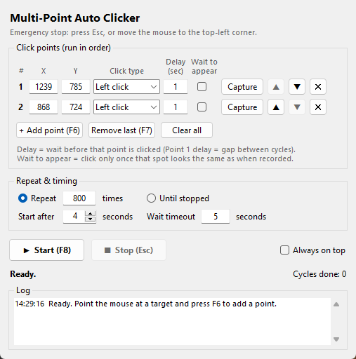

# Clicky 🖱️

A small desktop auto clicker that clicks a list of screen positions in order and repeats the sequence. It fits
repetitive flows like these: click a box in an app, press "Yes" in the pop-up, then press "Save" in the next one.

It can also wait until a target is really on screen before clicking it. A slow pop-up then never causes a click in
the wrong place.

I hate downloading auto clickers from Sourceforge so I made this and also they don't have what I want.



## Features

- Up to 50 click points, run one after another
- Left, double or right click for each point
- A delay before each point, decimals allowed
- **Wait to appear**: clicks only once the spot looks the way it did when you recorded it
- Repeat a fixed number of times, or until you stop it
- Global hotkeys, so you can record points without leaving the target app
- Emergency stop with Esc, or by moving the mouse to the top-left corner
- Points and settings are saved automatically
- Accurate clicks on scaled Windows displays such as 125% or 150%

## Requirements

- Python 3.8 or newer, with tkinter. The python.org installers for Windows and macOS include it. On Debian or
  Ubuntu, install `python3-tk`.
- [pynput](https://pypi.org/project/pynput/) for mouse control and hotkeys
- [Pillow](https://pypi.org/project/Pillow/) for **Wait to appear**. Everything else works without it.

## Install and run

```sh
pip install pynput pillow
python auto_clicker.py
```

On Windows you can also double-click `auto_clicker.py`. If a library is missing, the app tells you what to install.

## Quick start

1. Open the app you want to automate.
2. Hover the mouse over the first thing to click and press **F6**. The point appears in the list.
3. Do the same for each next step. If a step only appears after an earlier click, like a pop-up, bring it up on
   screen first, then press F6 over it.
4. Set a delay for each point and the number of repeats.
5. Press **F8** or click **Start**.
6. Press **Esc** to stop.

## Using it

### Click points

Each row is one click, run from top to bottom.

| Column         | Meaning                                                      |
| -------------- | ------------------------------------------------------------ |
| X, Y           | Screen position in physical pixels. You can type new values. |
| Click type     | Left click, Double click or Right click                      |
| Delay (sec)    | Wait before this point is clicked                            |
| Wait to appear | Click only when the target is visible, see below             |

Row buttons: **Capture** records a new position after a 3 second countdown. **▲ ▼** reorder the points and
**✕** deletes one.

**+ Add point** works like F6 but gives you 3 seconds to move the mouse into place. A new point copies the delay and
Wait to appear setting of the point before it.

### Delays

The delay is the wait before that point is clicked. In the first cycle, Point 1 is clicked right after the start
countdown. In later cycles, Point 1's delay is the gap between cycles.

### Wait to appear

When you add or capture a point, the app saves a 17x17 pixel snapshot of the screen around it. With Wait to appear
on, the app moves the cursor to the point and watches that area until it matches the snapshot again, then clicks.
A match means at most 8% of the pixels differ, two checks in a row, so the target has finished drawing. Since the
cursor already rests on the point, hover effects look the same as when you recorded it.

If the target does not show up within the **Wait timeout**, the run stops rather than clicking blind.

Tips:

- Record the point while the target is on screen, in the state you want to click.
- After typing a new X or Y, press **Capture** again. The old snapshot belongs to the old position.
- Pick a spot with steady content. Clocks, animations and video never match.

### Repeat and timing

- **Repeat N times**, or **Until stopped**.
- **Start after**: a 0 to 60 second countdown before the first click, to switch to the target app. Esc cancels it.
- **Wait timeout**: how long Wait to appear waits for each point, from 0.5 to 600 seconds.

## Hotkeys

Hotkeys are global. They work while another window has focus.

| Key | Action                              |
| --- | ----------------------------------- |
| F6  | Add a point at the mouse position   |
| F7  | Remove the last point               |
| F8  | Start or stop                       |
| Esc | Stop, or cancel a capture countdown |

## Safety

- **Emergency stop**: press Esc, or push the mouse into the top-left corner of the screen. The corner is checked
  before every click and while waiting for a target.
- Start refuses points inside that corner and points covered by the auto clicker's own window.
- Points are locked while a run is in progress.
- Some games and websites forbid automated input. Check their rules first.

## Saved settings

Points and settings live in `auto_clicker_config.json`, next to `auto_clicker.py`. A PyInstaller build keeps it next
to the `.exe`. The file is written when you add, capture, move or remove points, start a run, or close the app. Delete it to
start fresh.

The file holds the small screen snapshots used by Wait to appear. Do not share it if those spots show private data.

## Advanced settings

Constants at the top of `auto_clicker.py`:

| Name                                                        | Default         | Meaning                                                   |
| ----------------------------------------------------------- | --------------- | --------------------------------------------------------- |
| `HOTKEY_ADD`, `HOTKEY_UNDO`, `HOTKEY_TOGGLE`, `HOTKEY_STOP` | F6, F7, F8, Esc | Hotkeys, as pynput keys                                   |
| `MAX_POINTS`                                                | 50              | Most points in the list                                   |
| `HOVER_PAUSE`                                               | 0.05            | Seconds between moving the cursor and pressing the button |
| `CORNER`                                                    | 3               | Size in pixels of the emergency corner                    |
| `WATCH_RADIUS`                                              | 8               | Snapshot half-size. 8 gives a 17x17 box.                  |
| `PIXEL_DIFF`                                                | 35              | Color difference at which a pixel counts as changed       |
| `MATCH_RATIO`                                               | 0.08            | Share of changed pixels still treated as a match          |
| `POLL_SECONDS`                                              | 0.08            | Seconds between screen checks                             |
| `SETTLE_SECONDS`                                            | 0.10            | Pause after the target appears, before the click          |

Saved snapshots stop loading after a `WATCH_RADIUS` change. Capture those points again.

## Platform support

Developed on Windows. pynput and Pillow also support macOS and Linux, but the app is untested there.

- macOS: give your terminal Accessibility and Screen Recording permission.
- Linux: pynput needs an X11 session.

## Contributing

Issues and pull requests are welcome.
